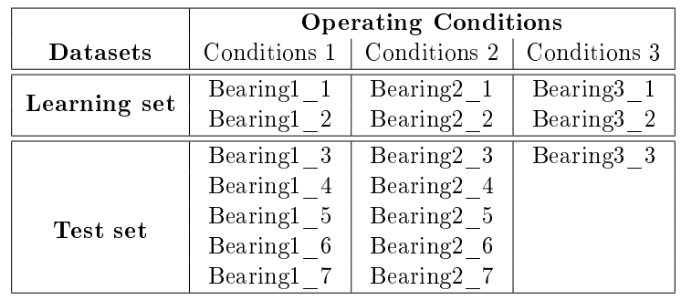
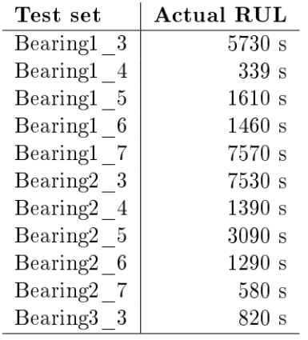
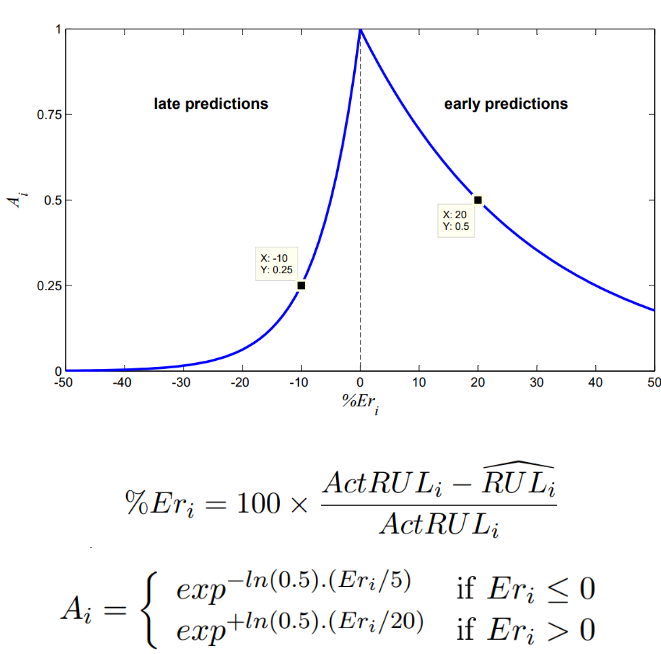
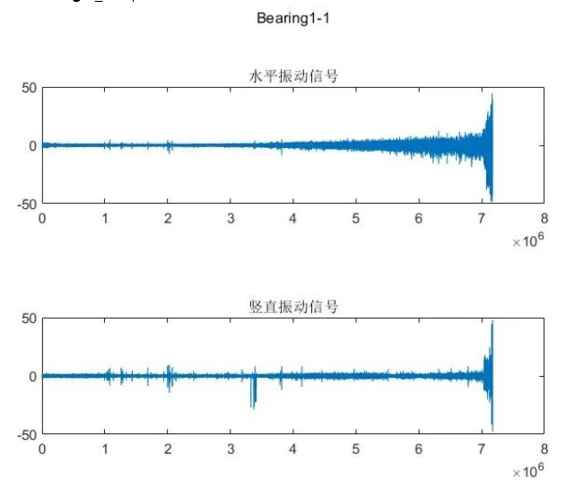
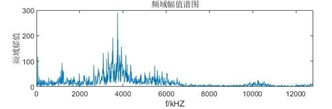
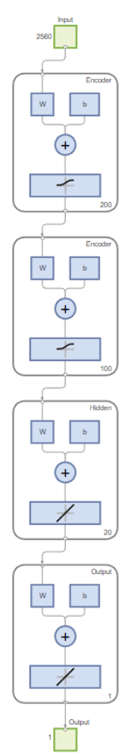
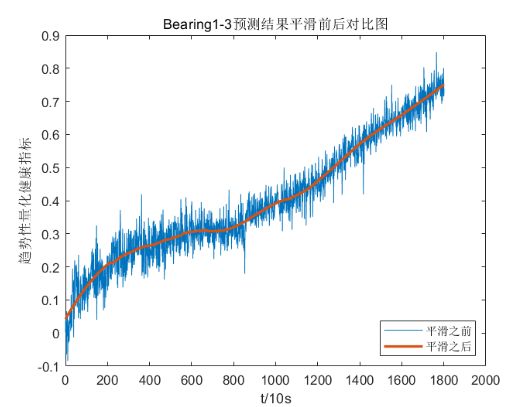
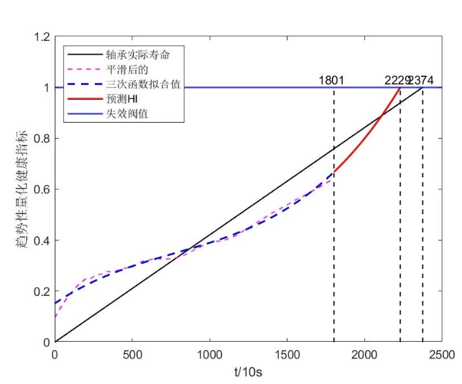
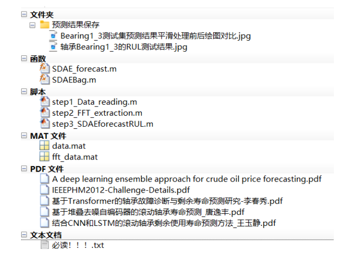

# Bearing Life Prediction Based on Stacked Denoising Autoencoder (SDAE) in MATLAB Code

1. Previously, we released a paper on the life prediction of bearings using Transformer-LSTM networks. This time, we introduce another classic deep learning network often used in life prediction papers: Stacked Denoising Autoencoder (SDAE).
Although the performance of SDAE is not as good as advanced deep learning methods like Transformer, its simple network structure and shorter training time make it frequently seen in life prediction papers.

2. Summary
There are countless articles and codes on the internet about bearing life prediction, but the quality is worryingly low, with many articles even suspected to be misleading. This code was painstakingly compiled by Xiao Tao over several sleepless nights, aiming to quickly master the entire process of bearing life prediction.
To avoid misleading my readers, this work references several highly cited classic papers on bearing life prediction, and the implementation details are as follows:
On the PHM2012 data set, an SDAE network is used to predict the remaining life of the bearing.
Regarding the PHM2012 dataset, there are many introductions online, and I have also included the official documentation for this data set in the code compression package. For a basic introduction to the PHM2012 dataset, you can refer to this link: https://zhuanlan.zhihu.com/p/583606882
Here's just how to use this dataset! Many articles online have made mistakes!
Attached is a picture of the PHM2012 dataset:
\n        \n      Focusing on Case 1 for example. The official PHM2012 dataset documentation mentions that in the training set Bearing1_1 and Bearing1_2, both bearings were from healthy conditions until they completely failed, and if health indicators are quantified with 0-1, then the moment when they completely failed corresponds to 1. So, the key point comes out!
The test set Bearing13~Bearing17, although also transitioned from a healthy state to complete failure, does not include all the data points from a healthy state to complete failure as provided by the official dataset. Instead, it is cut off just before complete failure. Therefore, the last data point in the test set does not represent the complete failure state, and health indicators cannot be directly linked to 1. Here are the actual time frames required for the test set to reach complete failure, which represents the true remaining lifespan:
\n        \n  
The next step is to train the deep learning network model on the training set and then feed the test set into the model for prediction. The prediction results should be fitted with a curve to determine the time when the prediction fails. This allows us to compare this time with the actual lifespan mentioned above, thereby assessing the quality of your model!
The official document also provides a scoring rule:
\n        \n  
Alright, after understanding this part, let's move on to the model prediction results for this issue!
SDAE bearing life prediction results
This period's code flow:
Step 1: Read the PHM2012 dataset and plot the time-domain waveforms of each bearing. In this session, we use the horizontal signals from Bearing1_1 and Bearing1_2 as the training set, and the horizontal signal from Bearing1_3 as the test set. The time-domain waveforms for Bearing1_1 through Bearing1_3 have been plotted, and here we only show the waveform for Bearing1_1:
\n        \n      Step two, perform a fast Fourier transform on the data obtained in the first step. Here, only the result of the FFT transformation for the first data point of Bearing1_1 is shown:
3. Third Step: The processed data from the second step is fed into the SDAE network for training. During the training process, Bearing11 and Bearing12 are used as the training set, while Bearing1_3 and Bearing1_4 are used as the test set. The SDAE model built in this session is shown in the following figure:

4. Fourth Step: Smooth filtering of the prediction results is performed, where the predicted results of Bearing1_3 and the smoothed curve are placed on the same graph:

5. Fifth Step: Polynomial fitting of the smoothed curve is conducted, and the predicted lifespan of Bearing1_3 under the SDAE model is as follows:

Here's a brief explanation of how to understand this image:
1801 represents the official cut-off lifespan of Bearing1_3, meaning it has not yet completely failed at 1801s! The pink dashed line represents the curve after smoothing the prediction values, the blue dashed line represents the curve fitted by polynomial fitting, and predicting the time when the failure threshold is reached is the model's prediction result. The black line represents the actual lifespan of the bearing, which shows that the actual failure time was 2374s, whereas the SDAE model predicted the failure time to be 2229s, with a difference of 2374-2229=145s.
The above prediction results do not require secondary adjustments; they can be directly output as a graph!
Previously published article: "Transformer-LSTM Network for Bearing Lifespan Prediction", which means the failure time predicted by the Transformer-LSTM model was 2262s, only differing by 112s from the actual remaining lifespan.
It can be seen that the SDAE network introduced in this issue is slightly inferior to the Transformer-LSTM model introduced in the previous article. Therefore, the SDAE network introduced in this issue is more suitable for use as a comparative model in a paper.
References:
[1] Wang Yujing, Li Shaopeng, Kang Shouchang, et al. Prediction Method of Remaining Lifespan of Rolling Bearings Based on CNN and LSTM [J]. Vibration. Testing and Diagnosis, 2021, 41(03): 439-446+617. DOI: 10.16450/j.cnki.issn.1004-6801.2021.03.003.
[2] Li Chunxiao. Research on Bearing Fault Diagnosis and Remaining Life Prediction Based on Transformer [D]. Shijiazhuang University of Railway, 2023. DOI: 10.27334/d.cnki.gstdy.2023.000614.
[3] Tang Yifeng, Xu Fan, Xu Dongliang. Rolling Bear Life Prediction Based on Stacked Denoising Autoencoder [J]. Automatics and Instrumentation, 2024, 39(10): 124-130.
​  
Code directory screenshot:
\n        \n  

## Images

<!-- PAYMENT_BLOCK -->

## Get this dataset

- Payment link (Stripe): [Buy now](https://buy.stripe.com/3cs8yP7sY87d0vu9AB)
- Payment QR code: 

<!-- /PAYMENT_BLOCK -->
